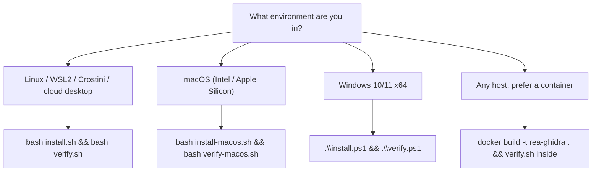
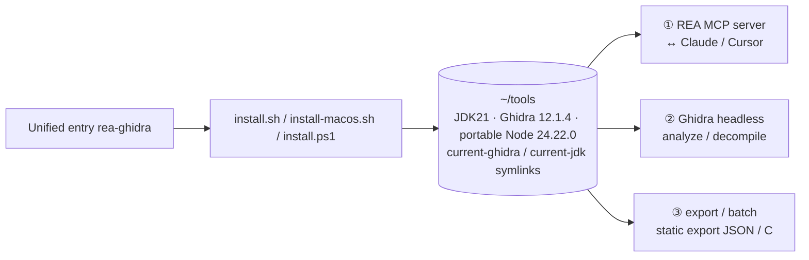

English | [简体中文](README.md)

# REA + Ghidra one-click deployment for cloud desktops

[](https://github.com/yyds8170-ctrl/rea-ghidra-setup/actions/workflows/ci.yml)
[](https://github.com/yyds8170-ctrl/rea-ghidra-setup/releases)
[](LICENSE)
[](#which-one-should-i-use-quick-pick)
[](#version-history)
[](#version-history)
[](#version-history)
[](#version-history)

One-click deploy **REA (Reverse Engineer Anything) + Ghidra** on a cloud desktop / Linux server, so AI agents can analyze binaries, apps and captures and produce evidence-backed conclusions without source.

- **REA**: `github.com/morluto/rea`, open-source reverse-engineering orchestration framework (MCP server + CLI), MIT.
- **Ghidra**: `github.com/NationalSecurityAgency/ghidra`, NSA open-source decompiler, Apache-2.0.
- This repo contains only install/uninstall/verify scripts, skill files and docs (no bundled third-party binaries).

> **Maintainer: 洋洋 (Yangyang) — [yyds8170-ctrl](https://github.com/yyds8170-ctrl)**
>
> This is an **independent third-party installer/orchestrator**. It is **not affiliated with, endorsed by, or sponsored by** the NSA, Ghidra, morluto, or REA. "Ghidra" and "REA" are names of their respective owners, used here only for descriptive identification. Third-party copyright and licenses are retained; see [NOTICE](NOTICE) and [TRADEMARKS](TRADEMARKS.md).

## Contents

- [30-second quick start](#30-second-quick-start)
- [Which one should I use? (quick pick)](#which-one-should-i-use-quick-pick)
- [Tested results](#tested-results)
- [Architecture](#architecture)
- [FAQ](#faq)
- [Directory tree](#directory-tree)
- [Version history](#version-history)

## 30-second quick start

```bash
# Linux / macOS
git clone https://github.com/yyds8170-ctrl/rea-ghidra-setup.git
cd rea-ghidra-setup
./rea-ghidra install && ./rea-ghidra verify
```

```powershell
# Windows (no admin, user-level extraction)
git clone https://github.com/yyds8170-ctrl/rea-ghidra-setup.git
cd rea-ghidra-setup
.\rea-ghidra.ps1 install
.\rea-ghidra.ps1 verify
```

Or a one-liner without cloning:

```bash
# Linux / macOS
curl -fsSL https://raw.githubusercontent.com/yyds8170-ctrl/rea-ghidra-setup/main/install.sh | bash
```

```powershell
# Windows PowerShell
irm https://raw.githubusercontent.com/yyds8170-ctrl/rea-ghidra-setup/main/install.ps1 | iex
```

Package-manager (Homebrew / Scoop) assets and steps: see [packaging/README.md](packaging/README.md). No npm wrapper by design (rationale there).

You get JDK21 + Ghidra 12.1.4 + portable Node 24.22.0, automatically passing 9 end-to-end checks. Subcommands and self-update/rollback: see [docs/entry.en.md](docs/entry.en.md).

## Which one should I use? (quick pick)



> Unsure? Run `bash scripts/detect-env.sh` first. The table below is a no-mermaid fallback.

| System / env | Install | Verify | Notes |
| --- | --- | --- | --- |
| Linux (bare / VM / WSL2 / cloud) | `bash install.sh` | `bash verify.sh` | x86_64 full; arm64 auto-builds native |
| Windows 10/11 x64 (bare / VM / VDI) | `.\install.ps1` | `.\verify.ps1` | user-level no admin; ships PE fixture |
| macOS (Intel / Apple Silicon) | `bash install-macos.sh` | `bash verify-macos.sh` | Apple Silicon auto-builds native, clears quarantine |
| ChromeOS | enable Crostini, then `bash install.sh` | `bash verify.sh` | x86_64 full; arm64 needs native build |
| Docker (any host) | `docker build -t rea-ghidra .` | `verify.sh` in container | amd64/arm64; or `docker compose` |

Full 4-OS × 5-runtime status: [docs/platform-support-matrix.en.md](docs/platform-support-matrix.en.md).

## Tested results

- JDK 21 + Ghidra 12.1.4 installed and passes `rea doctor --provider ghidra` fully (incl. native decompiler).
- An ELF program with check/discount logic decompiled successfully, `confidence: observed`. Real output:

```c
// rea decompile ./demo secret_check (Ghidra 12.1.4)
int secret_check(int code)
{
  int iVar1;
  int code_local;
  if (code == 0x539) {            // 0x539 = 1337 (correct code)
    iVar1 = 1;
  } else if (code < 0x2329) {     // 0x2329 = 9001
    iVar1 = 0;
  } else {
    iVar1 = 2;
  }
  return iVar1;
}
```

Measured numbers (Ubuntu 22.04 x86_64): `verify` 9/9; `doctor` 7 pass / 2 warn / 0 fail; `export demo --kind all` → functions 21 / strings 83 / symbols 102 / calls 14 / decompiled 18; batch 3 targets first ~48s → second cached run ~1s (3/3 cached); MCP handshake `server=rea 6.5.0`, provider 12.1.4.

## Architecture



Three usage paths: ① register REA as an MCP server so Claude/Cursor call reverse tools; ② `rea analyze/decompile` or Ghidra headless; ③ `ghidra-export`/`batch-analyze` to dump binaries as machine-readable JSON/C without REA.

## Install (by platform)

- **Linux (bare / VM / WSL2 / Crostini / cloud)**: `bash install.sh`, then `source ~/.bashrc` (zsh: `~/.zshrc`).
- **Restricted networks**: `REA_MIRROR=cn bash install.sh` (Node/JDK via npmmirror, Huawei, TUNA; still official checksummed). See [docs/mirrors.en.md](docs/mirrors.en.md). Default `auto` probes official reachability.
- **Windows 10/11 x64 (no admin)**: `.\install.ps1` (user-level; sets user PATH).
- **macOS (Intel / Apple Silicon)**: `bash install-macos.sh` (auto-builds `mac_arm_64`, clears Gatekeeper quarantine).
- **ChromeOS**: open Crostini, then the Linux flow.
- **Parameterized/CI install**: `bash install.sh --yes --dry-run` etc. See [docs/configuration.en.md](docs/configuration.en.md) §4.

## MCP client wiring

```bash
bash scripts/mcp-setup.sh --list
bash scripts/mcp-setup.sh --client claude-desktop --dry-run
bash scripts/mcp-setup.sh --client claude-desktop --yes   # backs up .bak, merges only the rea entry
bash scripts/mcp-setup.sh --check                        # stdio handshake + Ghidra provider check
```
Windows: `pwsh -File .\scripts\mcp-setup.ps1 -Client claude-desktop -Check`. Details: [docs/mcp.en.md](docs/mcp.en.md).

## Verify

```bash
bash verify.sh        # 9 end-to-end analyze/decompile assertions
```

## Docker

```bash
# Build image (JDK21 + portable Node 24.22.0 + Ghidra 12.1.4 + global rea)
docker build -t rea-ghidra .
```

## Native Ghidra batch decompile (no REA)

```bash
scripts/ghidra-export.sh <binary> --out <dir> --kind all
bash scripts/selftest-export.sh
```
Details: [docs/export.en.md](docs/export.en.md). Batch parallel + snapshot cache: [docs/batch.en.md](docs/batch.en.md).

## Uninstall

Linux `./uninstall.sh`, macOS `./uninstall-macos.sh`, Windows `.\uninstall.ps1` — removes only this project's install.

## Troubleshooting

JDK version, Node gate, Gatekeeper, native build, Windows PATH/network drives, Docker: [docs/troubleshooting.en.md](docs/troubleshooting.en.md).

## Capabilities

End-to-end REA + Ghidra deploy on Linux/macOS/Windows/ChromeOS/Docker; user-level (no admin) install; official checksum verification for JDK/Node/Ghidra; China mirrors; offline/air-gapped install; MCP wiring for Claude Desktop/Cursor/VS Code/Claude Code; static JSON/C export; parallel batch with content cache; multi-arch fixture CI; self-update with checksums and current/rollback.

## Limitations

- Windows P0 supports only fixed local NTFS (no UNC/network/reparse); Windows on ARM64 unsupported (no upstream native).
- ChromeOS only via Crostini; bare-metal Linux arm64 and macOS Intel have no CI runner (documented only).
- Requires JDK **exactly 21** and Node ≥24.11 (or ≥22.19/26).

## Compliance / legal

Licensed under PolyForm Noncommercial 1.0.0. For authorized security research on systems you own or are permitted to test. Prohibited: bypassing DRM/license/anti-cheat, building cheats, unauthorized intrusion/scraping of live systems, or redistributing others' copyrighted code and assets.

## FAQ

- **Admin/root needed?** No. JDK21/Ghidra/portable Node extract to `~/tools` (Windows `%USERPROFILE%\tools`), user-level env only.
- **Firewall / slow downloads?** `REA_MIRROR=cn ./rea-ghidra install`; official checksums still enforced.
- **Why JDK 21? JDK17 errors?** Ghidra 12.x hard-requires JDK21; scripts auto-detect and use the portable JDK21.
- **Offline / air-gapped?** Yes — `prepare-offline` then `OFFLINE_DIR` (see offline.md, Chinese).
- **Uninstall?** The uninstall scripts above.
- **Self-update / rollback?** `./rea-ghidra self-update` (git ff-only; tarball checksums-verified, old files backed up); `current`/`rollback` when multiple versions coexist.
- **SmartScreen / Gatekeeper?** Windows click "run anyway"; macOS installer clears quarantine.
- **Multiple Ghidra versions?** Yes, all extract to `~/tools`; `current-ghidra` points at the active one.

## Directory tree

See the Chinese README [`README.md`](README.md#目录树) for the full annotated tree. Key files: `rea-ghidra` / `rea-ghidra.ps1` unified entry, `install*.sh` / `install.ps1`, `verify*.sh` / `verify.ps1`, `scripts/ghidra-export.*`, `scripts/batch-analyze.*`, `scripts/build-fixtures.sh`, `examples/walkthrough.sh`, `docs/`.

## Version history

- **v5.0.0 (2026-10-15, milestone release)**: closes the v4.1→v4.3 iteration — full doc sync, a new docs-site "Milestones" page tracking tag/commit/CI/Release assets/validation summary and a risk list, final health check all green (see docs-site/milestones.md).
- **v4.3.0 (2026-10-15, path/encoding/supply-chain hardening)**: batch target collection is now NUL-safe (`find -print0` + `read -d ''`) so filenames with embedded newlines/special chars are no longer split; WSL installers now warn when `TOOLS_DIR` points at `/mnt/*` (slow cross-fs IO, recommend `~/tools`); `check-versions.sh` gained an upstream-drift report — portable Node vs current LTS, pinned GHA actions list, and best-effort latest-major comparison (report-only, no blind upgrades).
- **v4.2.0 (2026-10-15, install lock + self-healing)**: installers now take an atomic mutex at `<TOOLS_DIR>/.install.lock` (mkdir) before unpacking, so two concurrent installs can't clobber the same dir; a live lock conflict exits with the new `RC_BUSY=14`; stale locks left by a killed previous install are detected (PID gone) and reclaimed without blocking; half-unpacked JDK/Ghidra dirs missing the marker binary are auto-cleaned before a fresh reinstall; new `scripts/selftest-install-lock.sh` (7 assertions, wired into lint-build); e2e/fixture `~/tools` cache gained `restore-keys` fallback.
- **v4.1.0 (2026-10-15, exit-code system)**: named exit codes unified (0 OK / 2 usage / 10 missing dependency / 11 checksum failure / 12 upstream-or-resource unavailable / 13 disk full) across install / install-macos / export / batch / args error paths; machine-readable JSON error envelope on non-TTY stderr for CI and wrappers; batch's 7 value-taking options now exit 2 with a clean Chinese message instead of crashing with an unbound variable; new `docs/exit-codes.md` + docs-site "Exit codes" page (zh/en); lint-build gained exit-code & JSON assertions.
- **v4.0.5 (2026-10-15, path-robustness fixes)**: D1 — installers now quote `JAVA_HOME`/`GHIDRA_INSTALL_DIR`/`PATH` in rc env blocks, so a spaced/Unicode `TOOLS_DIR` no longer word-splits; D2 — `ghidra-export.sh` takes targets as an argv-exact array (strictly single target) and works around Ghidra's ASCII-only `checkValidFilename` leaf-name rejection by staging to an ASCII temp name; D3 — `batch-analyze.sh` replaces GNU-only `grep -z` counting with a main-shell counter, making spaced/Chinese batch directories work (parallel, snapshot cache, `--continue`, garbage isolation all verified); D4 — `uninstall.sh` deletes targets line-by-line so spaced install prefixes uninstall cleanly. Verified: shellcheck 0 warnings, all `bash -n` green, verify 9/9, selftests, 5-case regression, checksums, 294 links 0 dead.
- **v4.0.4 (2026-10-15, health-check fixes)**: fixes driven by 46 bash tests + 10 Ghidra regression runs.
  - Portable Node download/progress logs went to stdout and were captured by command substitution, polluting the `~/.bashrc` env block and breaking PATH — progress/checksum logs now go to stderr; the rc block is again clean `export PATH=...` lines.
  - batch-analyze previously trusted only the exit code; a garbage/unknown binary exits 0 with no output yet was marked success — it now requires the per-kind result file to exist and be non-empty, else `failed` (no snapshot); added a random-garbage regression case.
  - Offline packages lagged the locked versions (node 22.19.0→24.22.0, rea-agents 6.4.0→6.5.0) — refreshed via `prepare-offline.sh`, regenerated checksums, removed old packages; a missing locked package now warns loudly before falling back to network instead of doing so silently.
  - `--help` printed source lines (`set -e...`/`SCRIPT_DIR=`) when the comment block grew — anchored to a `# END USAGE` sentinel.
  - install re-downloaded Node on every idempotent rerun — it now reuses an existing portable Node that satisfies REA.
  - batch `summary.json` accumulated historical results — non-`--continue` runs now clear prior results (continue semantics unchanged).
  - `build-fixtures.sh` always failed on a plain x86_64 host — added a guaranteed native x86_64 target and cleaned stale fixtures first.
  - Unified entrypoint gained `uninstall`/`detect-env`; `verify.sh`/`uninstall.sh` gained `--help` (previously `--help` ran the full 9-check e2e / entered interactive deletion).
- **v3.3 (2026-10-15)**: Compliance & governance — replaced the PolyForm template placeholder (Yoyodyne) in LICENSE with the real copyright holder (see LICENSE) and added a proper Required Notice; added NOTICE (third-party attribution + no-affiliation), TRADEMARKS (bilingual), CITATION.cff; added community-health files (Contributor Covenant 2.1, issue/PR templates, CODEOWNERS, FUNDING) and a Maintainer line. No functional change.
- **v3.2 (2026-10-15)**: Internationalization — English README + English docs index + 8 translated docs; language switch links; support matrix refresh; final review. No functional change.
- **v3.1 (2026-10-15)**: README polish — badges, TOC, 30-second start, mermaid decision/architecture diagrams, 8 FAQ; docs index completion; docs link checker added to CI.
- **v3.0 (2026-10-15, major)**: unified entrypoint `rea-ghidra`; self-update with checksums; multi-version `current`/`rollback`; centralized JDK/Ghidra discovery.
- **v2.9 (2026-10-15)**: upstream follow-through — portable Node 22.19.0→24.22.0, REA 6.4.0→6.5.0 (Ghidra 12.1.4/JDK21 unchanged); supply chain `checksums.txt` + SBOM; multi-arch fixture CI; end-to-end walkthrough.
- **v2.8 (2026-10-15)**: parallel batch analysis + snapshot cache; failure isolation and resumability.
- **v2.7 (2026-10-15)**: single-target Ghidra static export (functions/strings/symbols/calls/decompiled).
- **v1.0 (2026-10)**: first release — one-click JDK21 + Ghidra 12.1.4, reverse skill and tested results.
